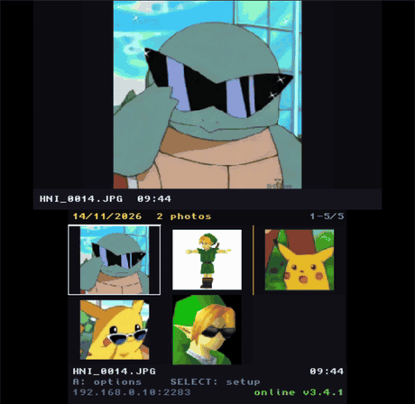
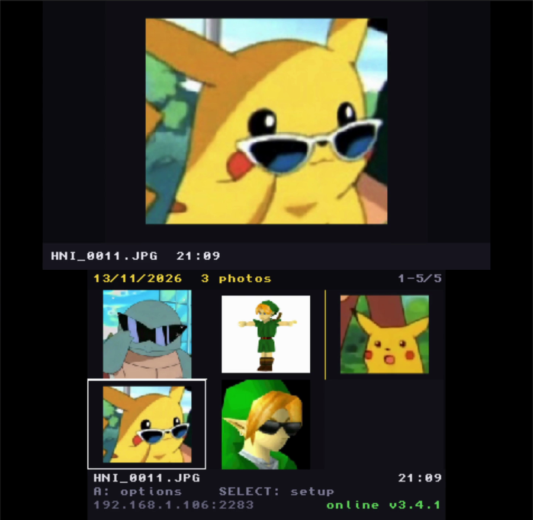
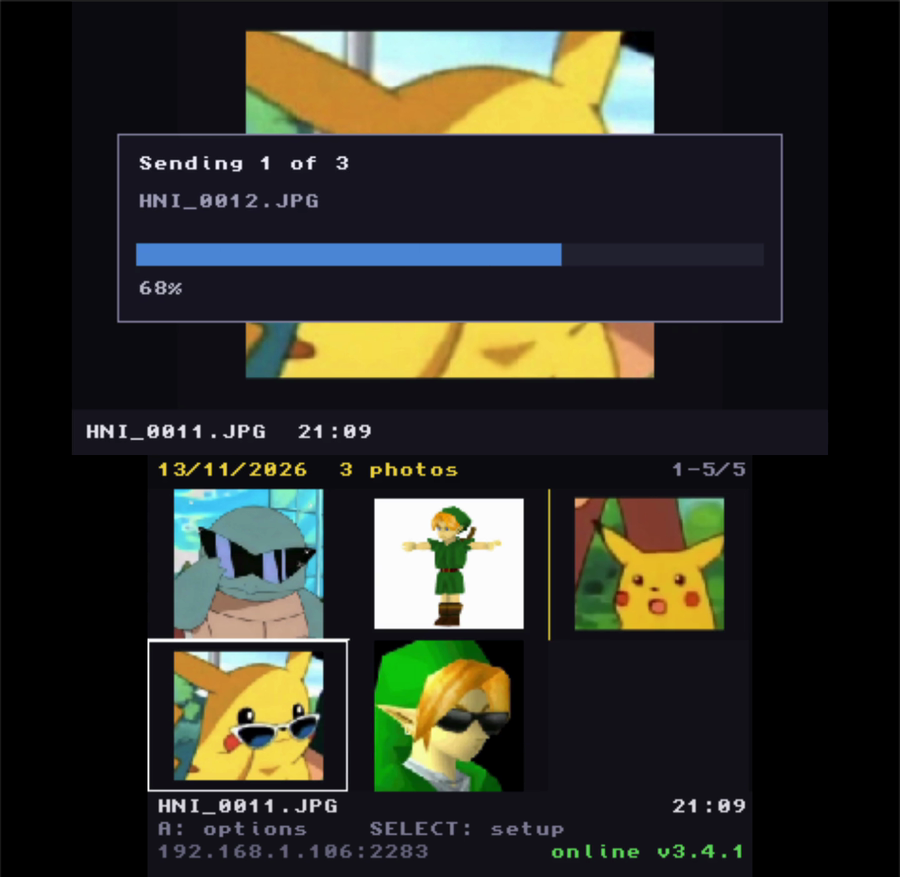
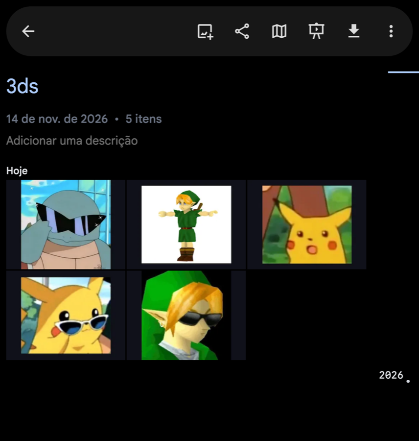
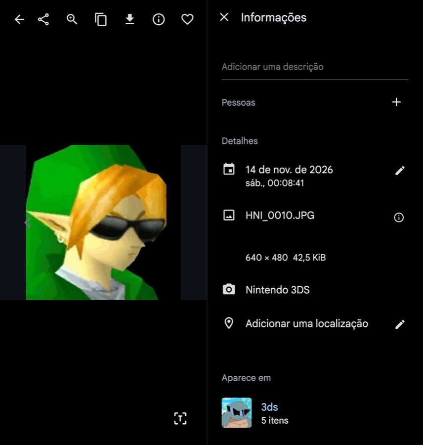
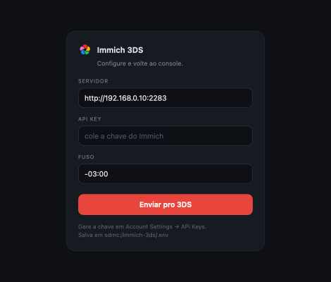

# immich-3ds

[](https://github.com/arthuregood/immich-3ds/actions/workflows/build.yml)

**English** · [Português](README.pt-BR.md)

Uploads the photos on your 3DS SD card to [Immich](https://immich.app). Runs on the console, talks to the Immich API — no PC, no card reader.



## How it works

The app lists what is in `sdmc:/DCIM`, grouped by day, newest first. The top screen shows the selected photo, the bottom screen is the thumbnail grid. Press A to send that one, or pick "send all from this day".

Dates come from the JPEG's EXIF, not from the file timestamp — 3DS clocks drift, the photo's own date doesn't.

| Gallery | Actions |
|---|---|
|  |  |

In Immich they arrive as normal photos, with the camera reported as Nintendo 3DS:

| Album | Photo details |
|---|---|
|  |  |

## What you need

- A 3DS or 2DS with [Luma3DS](https://github.com/LumaTeam/Luma3DS) and FBI
- An Immich server your console can reach on the network
- An API key from *Account Settings → API Keys*

## Install

Download `immich-3ds.cia` from [releases](../../releases), copy it to the SD card (e.g. `sdmc:/cias/`) and install it with FBI. It shows up in the Home Menu.

## First setup

There is nothing to type on the console. On first launch the app starts a small web server and shows the address on the top screen — open it on your phone, fill in the server URL and API key, send.



If you would rather not use the browser, write the file yourself:

```
sdmc:/immich-3ds/.env

IMMICH_SERVER=http://192.168.0.10:2283
IMMICH_API_KEY=your_key
IMMICH_TZ=-03:00
lang=pt
```

Only the first two are required. Both routes are also under **SELECT → setup**, together with the 3DS keyboard if you just need to fix one field.

## Controls

| Input | Action |
|---|---|
| D-pad | move through the photos |
| A / touch | open the menu |
| SELECT | setup |
| B | exit |

The footer shows the server and whether it answered: `online v3.4.1` or `offline`. It checks on boot and after you save the settings.

## Good to know

- Upload only for now; downloading from Immich to the 3DS is not implemented
- Reads `sdmc:/DCIM` only
- `.MPO` (3D photos) uploads as JPEG — Immich keeps the original file
- TLS 1.2 is the limit of the bundled mbedTLS
- The API key is stored in plain text on the SD card, so use a key you can revoke on its own

## Credits

Built with [devkitPro](https://devkitpro.org) / libctru, [curl](https://curl.se) + [mbedTLS](https://www.trustedfirmware.org/projects/mbed-tls/) and [libjpeg-turbo](https://libjpeg-turbo.org).

The Immich name and logo belong to the Immich project; this app is not official and not affiliated with it.

The sample images in `docs/` are fan memes used as test data. Characters are trademarks of Nintendo, and this project is not affiliated with, endorsed or sponsored by Nintendo.

## License

MIT — see [LICENSE](LICENSE). Build instructions, tests and release process are in [CONTRIBUTING.md](CONTRIBUTING.md).

By [arthuregood](https://github.com/arthuregood).
