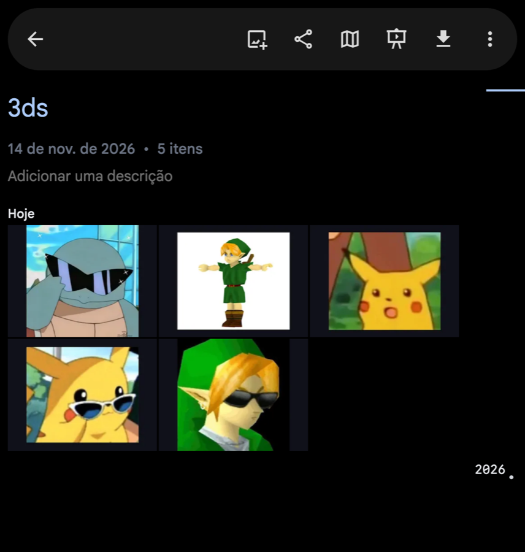
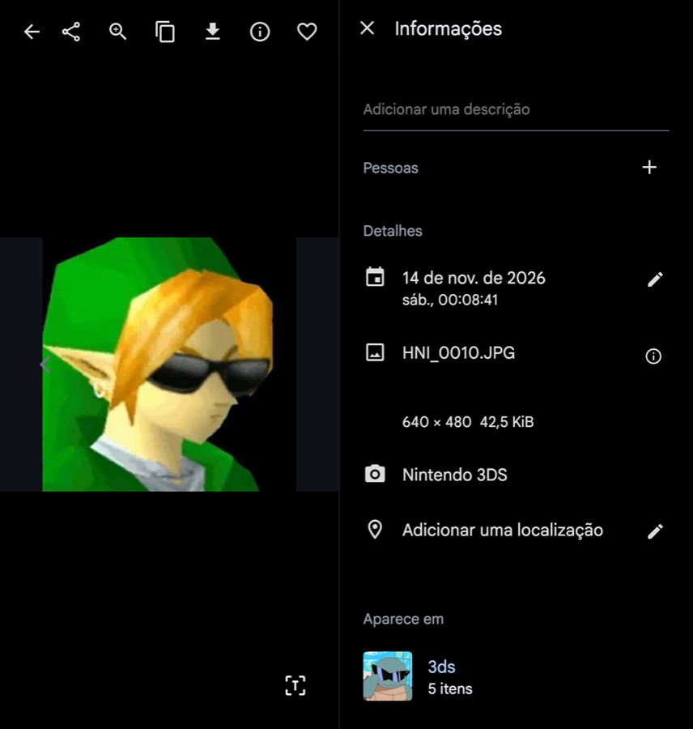

# immich-3ds

[](https://github.com/arthuregood/immich-3ds/actions/workflows/build.yml)

[English](README.md) · **Português**

Manda as fotos do cartão SD do 3DS pro [Immich](https://immich.app). Roda no console e fala direto com a API do Immich, sem PC no meio.


## Como funciona

Ele lê o `sdmc:/DCIM` e agrupa por dia, do mais recente pro mais antigo. Escolhe uma foto ou o dia inteiro e manda pro Immich. D-pad navega, A abre o menu, SELECT abre a configuração, B sai.

A data vem do EXIF do JPEG, não do horário do arquivo. O relógio do 3DS desregula; a data dentro da foto, não. O rodapé mostra o servidor e se ele respondeu.

| Galeria | Ações |
|---|---|
|  |  |

No Immich elas chegam como qualquer outra foto, com a câmera identificada como Nintendo 3DS:

| Álbum | Detalhes da foto |
|---|---|
|  |  |

## Antes de começar

- Um 3DS ou 2DS com [Luma3DS](https://github.com/LumaTeam/Luma3DS) e FBI
- Um servidor Immich que o console alcance
- Uma API key de *User Settings → API Keys*

## Instalar

Baixa o `immich-3ds.cia` nas [releases](../../releases), joga no cartão SD (tipo `sdmc:/cias/`) e instala pelo FBI. A mesma release tem um `.3dsx` pra quem usa o Homebrew Launcher.

Pra atualizar é a mesma coisa: instala o `.cia` novo por cima, que a configuração no cartão continua lá.

### Sem o cartão SD

Dá pra instalar direto pelo console. No FBI, **Remote Install → Scan QR Code**, aponta a câmera pra isso:


Hospedado fora do GitHub, então o link pode expirar; se expirar, usa o `.cia` da release.

## Primeira configuração

Na primeira vez não tem nada pra digitar. O app sobe um servidor e mostra o endereço na tela de cima: abre no celular, preenche a URL do servidor e a API key, manda.


Nada passa por fora: a página é servida pelo próprio console, então a chave vai do navegador direto pro 3DS, sem servidor externo no caminho.

A página não tem senha e mostra a chave que já está salva, então aperta B no console quando terminar, que fecha o servidor.

Se preferir não usar o navegador, escreve o arquivo:

```
sdmc:/immich-3ds/.env

IMMICH_SERVER=http://192.168.0.10:2283
IMMICH_API_KEY=sua_key
IMMICH_TZ=-03:00          # opcional, padrão -03:00; seu fuso em relação a UTC
lang=pt                   # opcional; sem isso o app segue o idioma do console
```

Só o servidor e a chave são obrigatórios. Os dois caminhos também estão no **SELECT → configurar**, junto com o teclado do 3DS.

## Se não funcionar

- **A página de configuração não abre.** Aquele endereço só funciona na mesma rede. O IP do console aparece em *Configurações do sistema → Configurações de internet → Teste de conexão*.
- **O rodapé diz `offline`.** O Wi-Fi está de pé, mas o Immich não respondeu. Testa a mesma URL no navegador do celular.
- **`could not open the port (wifi off?)`.** A porta 8080 está ocupada ou o Wi-Fi caiu. Tenta **SELECT → configurar → navegador** de novo.
- **`no photos in sdmc:/DCIM`.** As fotos não estão onde o app procura; veja a regra de pasta abaixo.

## Limites

- Só envia; baixar do Immich pro 3DS ainda não existe
- Lê `sdmc:/DCIM` um nível de subpasta, então as fotos precisam estar numa pasta como `sdmc:/DCIM/100NIN03/`
- Lista no máximo 512 fotos, o resto é ignorado
- `.MPO` (fotos 3D) sobe como JPEG; o Immich guarda o original
- O certificado **não é verificado** a menos que você ponha sua CA em `sdmc:/immich-3ds/ca.pem` (no Let's Encrypt, o arquivo é o ISRG Root X1)
- TLS 1.2 é o limite do mbedTLS embarcado
- A API key fica em texto plano no cartão, então usa uma que você consiga revogar sozinha

## Créditos

Feito com [devkitPro](https://devkitpro.org) / libctru, [curl](https://curl.se) + [mbedTLS](https://www.trustedfirmware.org/projects/mbed-tls/) e [libjpeg-turbo](https://libjpeg-turbo.org).

O nome e a logo da Immich são do projeto Immich. Este app não é oficial nem afiliado.

As imagens de exemplo em `docs/` são memes de fã usados como dado de teste. Os personagens são marcas da Nintendo, e este projeto não é afiliado, endossado ou patrocinado pela Nintendo.

## Licença

MIT, veja [LICENSE](LICENSE). Build, testes e processo de release estão no [CONTRIBUTING.md](CONTRIBUTING.md).

Por [arthuregood](https://github.com/arthuregood).
