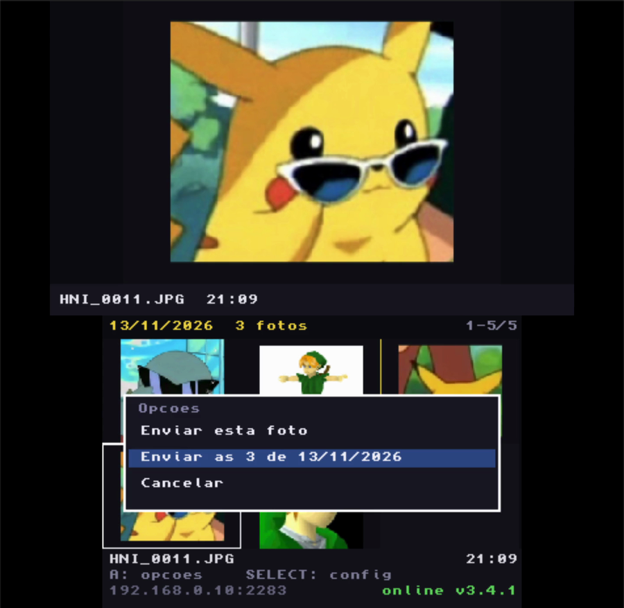
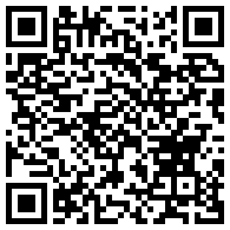

# immich-3ds

[](https://github.com/arthuregood/immich-3ds/actions/workflows/build.yml)

[English](README.md) · **Português**

Manda as fotos do cartão SD do 3DS pro [Immich](https://immich.app). Roda no console e fala direto com a API do Immich, sem PC no meio.


## Como funciona

Ele lê o `sdmc:/DCIM` e agrupa por dia, do mais recente pro mais antigo. Escolhe uma foto ou o dia inteiro e manda pro Immich. D-pad navega, o toque escolhe a miniatura, A abre o menu, SELECT abre a configuração, B na galeria fecha o app.

A data vem do EXIF do JPEG, não do horário do arquivo. O relógio do 3DS desregula; a data dentro da foto, não. O rodapé mostra o servidor e se ele respondeu.

| Galeria | Ações |
|---|---|
|  |  |

No Immich elas chegam como qualquer outra foto na linha do tempo, com a câmera identificada como Nintendo 3DS. O app não cria álbum; esse aí foi feito na mão:

| Linha do tempo | Detalhes da foto |
|---|---|
|  |  |

## Antes de começar

- Um 3DS ou 2DS com [Luma3DS](https://github.com/LumaTeam/Luma3DS) e FBI
- Um servidor Immich que o console alcance
- Uma API key em *User Settings → API Keys*, com permissão de upload (ou todas)

## Instalar

Baixa o `immich-3ds.cia` nas [releases](../../releases), joga no cartão SD (tipo `sdmc:/cias/`) e instala pelo FBI. A mesma release tem um `.3dsx` pra quem usa o Homebrew Launcher; ele vai em `sdmc:/3ds/`.

Pra atualizar é a mesma coisa: instala o `.cia` novo por cima, que a configuração no cartão continua lá.

### Sem cartão SD

Dá pra instalar direto pelo console. No FBI, **Remote Install → Scan QR Code**, aponta a câmera pra isso:



Ele sempre baixa a release mais nova, então esse código não muda entre versões.

## Primeira configuração

A primeira vez é pelo navegador: ao abrir, o app sobe um servidor e mostra o endereço na tela de cima. Abre esse endereço no celular, preenche a URL do servidor, a API key e o fuso, e toca em Enviar.


A página é servida pelo próprio console, então a chave sai do navegador direto pro 3DS, sem serviço de terceiro no meio. Dali em diante ela só vai pro seu Immich.

A página não tem senha e mostra a chave que já está salva, então não abre isso com gente olhando. Salvar já fecha o servidor sozinho; pra desistir sem salvar, aperta B no console.

Se preferir não usar o navegador, escreve o arquivo:

```
sdmc:/immich-3ds/.env

IMMICH_SERVER=http://192.168.0.10:2283
IMMICH_API_KEY=sua_key

# opcional, padrão -03:00. Seu fuso em relação a UTC.
IMMICH_TZ=-03:00

# opcional. Sem isso, console em português usa português, o resto usa inglês.
lang=pt
```

Só servidor e chave são obrigatórios. Dá pra trocar tudo isso depois pelo **SELECT → configurar**, que abre o navegador ou o teclado do 3DS.

## Se não funcionar

- **A página de configuração não abre.** Aquele endereço só funciona no mesmo Wi-Fi, com o console parado naquela tela. Confere se o console está conectado (*Configurações do sistema → Configurações de internet → Teste de conexão*) e se o celular está na mesma rede, não no 4G.
- **O rodapé diz `offline`.** O Wi-Fi está de pé, mas o Immich não respondeu. Abre a mesma URL no navegador do celular. Se lá abre e no console continua `offline`, é TLS: o app para no TLS 1.2, então servidor que só oferece 1.3 não conecta.
- **`nao consegui abrir a porta (wifi off?)`.** A porta 8080 está ocupada ou o Wi-Fi caiu. Tenta **SELECT → configurar → navegador** de novo.
- **`nenhuma foto em sdmc:/DCIM`.** As fotos não estão onde o app procura; veja a regra de pasta abaixo.

## Limites

- Só envia; baixar do Immich pro 3DS ainda não existe
- Mandar a mesma foto duas vezes é seguro: o Immich responde `duplicate` e a tela de resultado conta em vez de subir de novo
- Lê `sdmc:/DCIM` um nível de subpasta, então as fotos precisam estar numa pasta como `sdmc:/DCIM/100NIN03/`
- Lista no máximo 512 fotos. Passando disso, ele pega as 512 primeiras que o cartão devolve e só então ordena, então as mais novas podem ficar de fora
- `.MPO` (fotos 3D) sobe como JPEG; o Immich guarda o original
- O certificado **não é verificado** a menos que você ponha sua CA em `sdmc:/immich-3ds/ca.pem` (no Let's Encrypt, o arquivo é o ISRG Root X1)
- TLS 1.2 é o limite do mbedTLS embarcado
- A API key fica em texto plano no cartão, então usa uma chave só sua, que você possa revogar sem quebrar outro cliente

## Créditos

Feito com [devkitPro](https://devkitpro.org) / libctru, [curl](https://curl.se) + [mbedTLS](https://www.trustedfirmware.org/projects/mbed-tls/) e [libjpeg-turbo](https://libjpeg-turbo.org).

O nome e a logo da Immich são do projeto Immich. Este app não é oficial nem afiliado.

As imagens em `docs/` são memes de fã, usados só como dados de teste. Os personagens são marcas da Nintendo; este projeto não é afiliado, endossado nem patrocinado por ela.

## Licença

MIT, veja [LICENSE](LICENSE). Build, testes e processo de release estão no [CONTRIBUTING.md](CONTRIBUTING.md).

Por [arthuregood](https://github.com/arthuregood).
