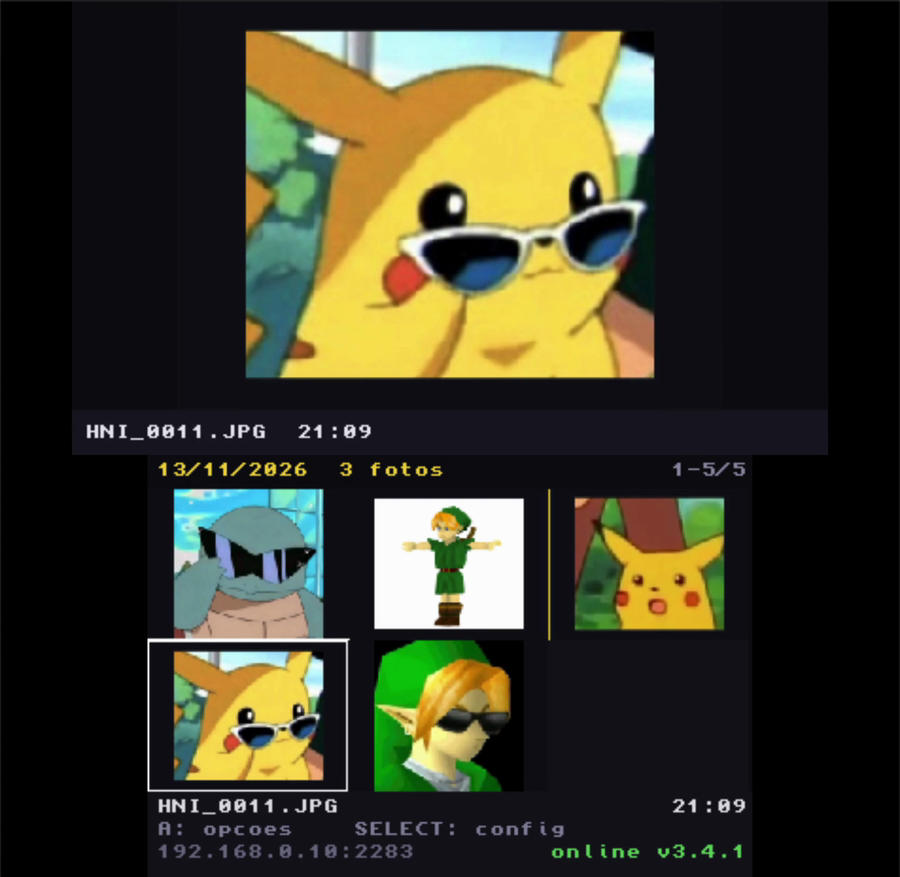

# immich-3ds

[](https://github.com/arthuregood/immich-3ds/actions/workflows/build.yml)

[English](README.md) · **Português**

Manda as fotos do cartão SD do seu 3DS para o [Immich](https://immich.app). Roda no console e fala direto com a API do Immich, sem PC no meio.


## Como funciona

O app lista o que está em `sdmc:/DCIM`, agrupado por dia, do mais recente para o mais antigo. A tela de cima mostra a foto selecionada, a de baixo é a grade de miniaturas. Aperte A para enviar aquela foto, ou escolha "enviar todas deste dia".

A data vem do EXIF do JPEG, não do timestamp do arquivo. O relógio do 3DS desregula; a data dentro da foto não.

| Galeria | Ações |
|---|---|
|  |  |

No Immich elas chegam como qualquer outra foto, com a câmera identificada como Nintendo 3DS:

| Álbum | Detalhes da foto |
|---|---|
|  |  |

## O que você precisa

- Um 3DS ou 2DS com [Luma3DS](https://github.com/LumaTeam/Luma3DS) e FBI
- Um servidor Immich que o console alcance
- Uma API key de *User Settings → API Keys*

## Instalar

Baixe `immich-3ds.cia` nas [releases](../../releases), copie para o cartão SD (ex: `sdmc:/cias/`) e instale pelo FBI. A mesma release tem um `.3dsx` se você preferir o Homebrew Launcher.

Para atualizar depois, instale o `.cia` novo do mesmo jeito. Ele substitui o app e mantém a configuração que está no cartão SD.

## Primeira configuração

Não precisa digitar nada no console. Na primeira vez o app sobe um pequeno servidor web e mostra o endereço na tela de cima. Abra no celular, preencha a URL do servidor e a API key, envie.


Essa página não tem senha e mostra a chave que já está salva. Aperte B no console quando terminar, o que fecha o servidor.

Se preferir não usar o navegador, escreva o arquivo na mão:

```
sdmc:/immich-3ds/.env

IMMICH_SERVER=http://192.168.0.10:2283
IMMICH_API_KEY=sua_key
IMMICH_TZ=-03:00          # opcional, padrão -03:00; seu fuso em relação a UTC
lang=pt                   # opcional; sem isso o app segue o idioma do console
```

Só o servidor e a chave são obrigatórios. Os dois caminhos também estão em **SELECT → configurar**, junto com o teclado do 3DS para quando você só quer corrigir um campo.

## Se não funcionar

- **A página de configuração não abre.** Aquele endereço só funciona na mesma rede. O IP do console aparece em *Configurações do sistema → Configurações de internet → Teste de conexão*.
- **O rodapé diz `offline`.** O Wi-Fi está de pé, mas o Immich não respondeu. Teste a mesma URL no navegador do celular.
- **`could not open the port (wifi off?)`.** A porta 8080 está ocupada ou o Wi-Fi caiu. Tente **SELECT → configurar → navegador** de novo.
- **`no photos in sdmc:/DCIM`.** As fotos não estão onde o app procura; veja a regra de pasta abaixo.

## Controles

| Tecla | Ação |
|---|---|
| D-pad | navegar pelas fotos |
| A / toque | abrir o menu |
| SELECT | configuração |
| B | sair |

O rodapé mostra o servidor e se ele respondeu: `online` com a versão do servidor, ou `offline`. A checagem roda no boot e depois de salvar a configuração.

## Bom saber

- Por enquanto só envia; baixar do Immich para o 3DS não existe
- Lê `sdmc:/DCIM` um nível de subpasta, então as fotos precisam estar dentro de uma pasta como `sdmc:/DCIM/100NIN03/`, não soltas em `sdmc:/DCIM`
- Lista no máximo 512 fotos; o que passar disso é ignorado
- `.MPO` (fotos 3D) sobe como JPEG, e o Immich guarda o arquivo original
- HTTPS funciona, mas o certificado **não é verificado** a menos que você coloque sua CA em `sdmc:/immich-3ds/ca.pem`. Para Let's Encrypt, esse arquivo é o certificado ISRG Root X1
- TLS 1.2 é o limite do mbedTLS embarcado
- A API key fica em texto plano no cartão, então use uma que você possa revogar sozinha

## Créditos

Feito com [devkitPro](https://devkitpro.org) / libctru, [curl](https://curl.se) + [mbedTLS](https://www.trustedfirmware.org/projects/mbed-tls/) e [libjpeg-turbo](https://libjpeg-turbo.org).

O nome e a logo da Immich pertencem ao projeto Immich. Este app não é oficial nem afiliado.

As imagens de exemplo em `docs/` são memes de fã usados como dado de teste. Os personagens são marcas da Nintendo, e este projeto não é afiliado, endossado ou patrocinado pela Nintendo.

## Licença

MIT, veja [LICENSE](LICENSE). Instruções de build, testes e processo de release estão no [CONTRIBUTING.md](CONTRIBUTING.md).

Por [arthuregood](https://github.com/arthuregood).
