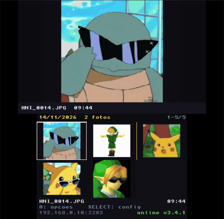
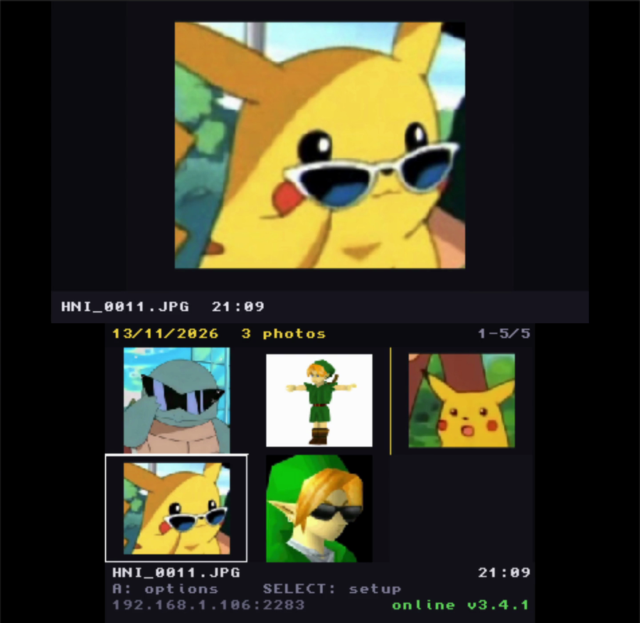
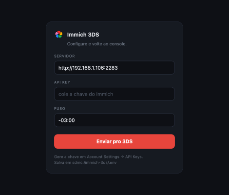

# immich-3ds

[English](README.md) · **Português**

Manda as fotos do seu Nintendo 3DS direto para o seu servidor [Immich](https://immich.app) — sem PC no meio.



## O que ele faz

- Varre `sdmc:/DCIM`, agrupado por dia, do mais recente para o mais antigo
- Foto inteira na tela de cima, grade de miniaturas na de baixo
- Envia uma foto ou todas do dia, com popup de progresso
- **Sem digitar nada no console**: na primeira vez ele abre uma página de configuração no navegador do celular
- Idioma da interface segue o console (português ou inglês)
- Ícone e banner próprios no menu inicial

| Galeria | Menu de ações |
|---|---|
|  |  |

## Por que não AirDrop

AirDrop não é possível no 3DS, e não é questão de criptografia: a descoberta roda sobre **AWDL**, um
protocolo de rádio que exige monitor mode e injeção de frames — coisas que o firmware fechado do 3DS
não expõe, e o menu do iPhone só lista quem fala AWDL. Reimplementações abertas como o
[OpenDrop](https://github.com/seemoo-lab/opendrop) só funcionam em placas Wi-Fi com monitor mode
ativo.

O caminho que funciona é o Immich: o 3DS sobe as fotos e o iPhone as vê no app do Immich. O outro
sentido vem de graça.

## Requisitos

- 3DS/2DS com [Luma3DS](https://github.com/LumaTeam/Luma3DS) e FBI
- Um servidor Immich acessível pelo console (mesma rede, HTTP ou HTTPS)
- Uma API key do Immich (*Account Settings → API Keys*)

## Instalar

Baixe `immich-3ds.cia` na página de [releases](../../releases), copie para o cartão SD
(por exemplo `sdmc:/cias/`) e instale com o **FBI**. Ele aparece no menu inicial.

Alternativamente, compile e use o `.3dsx` pelo Homebrew Launcher.

## Configurar

### Primeira vez: pelo celular ou PC

Sem configuração, o app sobe um pequeno servidor web e mostra o endereço na tela de cima:



Abra esse endereço, preencha servidor, API key e fuso, e toque em **Enviar pro 3DS**. O app salva em
`sdmc:/immich-3ds/.env`, testa a conexão e volta para a galeria.

O mesmo modo existe depois de configurado: **SELECT → Configurar pelo navegador**.

### Ou: um arquivo `.env` no cartão

Crie `sdmc:/immich-3ds/.env`:

```
IMMICH_SERVER=http://192.168.0.10:2283
IMMICH_API_KEY=sua_api_key
IMMICH_TZ=-03:00
lang=pt
```

Só `IMMICH_SERVER` e `IMMICH_API_KEY` são obrigatórios. `lang` (`pt`/`en`) força o idioma.
O app reescreve esse mesmo arquivo quando você configura pela tela ou pelo navegador.

### Ou: o teclado do 3DS

**SELECT → Configurar no teclado**. A key tem ~60 caracteres, então isso serve para corrigir um
campo, não para a primeira configuração.

## Usando

| Tecla | Ação |
|---|---|
| D-pad ← → ↑ ↓ | navegar pelas fotos |
| A / toque | abrir o menu (enviar esta foto, enviar todas do dia) |
| SELECT | configuração |
| B | sair |

O rodapé mostra o servidor e o estado: `online v3.4.1` ou `offline` (checado no boot e ao salvar a
configuração).

## Limitações

- Só envia; baixar do Immich para o 3DS ainda não existe
- Lê apenas `sdmc:/DCIM` (fotos da câmera e jogos que salvam ali)
- `.MPO` (fotos 3D) sobem como JPEG: o Immich mostra o primeiro frame e preserva o original
- TLS 1.2 é o teto do mbedTLS embarcado — servidor que só aceita TLS 1.3 não conecta
- A API key fica em texto plano no cartão. Use uma key dedicada, para revogar só ela

## Compilar

```sh
./build.sh          # gera .3dsx e .cia via Docker (não precisa de devkitPro)
```

Com devkitPro instalado nativamente, `make` usa `$DEVKITARM`; a etapa do `.cia` precisa do
[makerom](https://github.com/3DSGuy/Project_CTR).

Opcional: copie `.env.example` para `.env` para embutir servidor e key no binário em tempo de build
(útil para distribuir uma build já configurada — mas aí o `.cia` carrega a sua key).

## Regerar as imagens do README

O GIF foi gravado com uma flag que percorre a interface sozinha e finge o envio (não precisa de
servidor):

```sh
make CFLAGS_EXTRA=-DDEMO
```

## Testes

```sh
./tests/run.sh
```

Cobre o leitor de data EXIF e o parser urlencoded da página de configuração. Os dois compilam no host,
sem emulador.

## Créditos e notas legais

- Feito com [devkitPro](https://devkitpro.org) / libctru, [curl](https://curl.se) +
  [mbedTLS](https://www.trustedfirmware.org/projects/mbed-tls/), [libjpeg-turbo](https://libjpeg-turbo.org)
  e [makerom](https://github.com/3DSGuy/Project_CTR).
- O nome e a logo da Immich pertencem ao projeto [Immich](https://immich.app). Este app **não é
  oficial** nem afiliado; a logo está aqui só para identificar o serviço que você conecta.
- As imagens de exemplo em `docs/` são memes de fã usados **apenas como dado de teste**. Personagens e
  artes são marcas da **Nintendo**; este projeto não é afiliado, endossado ou patrocinado pela Nintendo.
  Se você fizer um fork, troque essas imagens por algo seu.

## Licença

MIT — veja [LICENSE](LICENSE).

Por [arthuregood](https://github.com/arthuregood).
